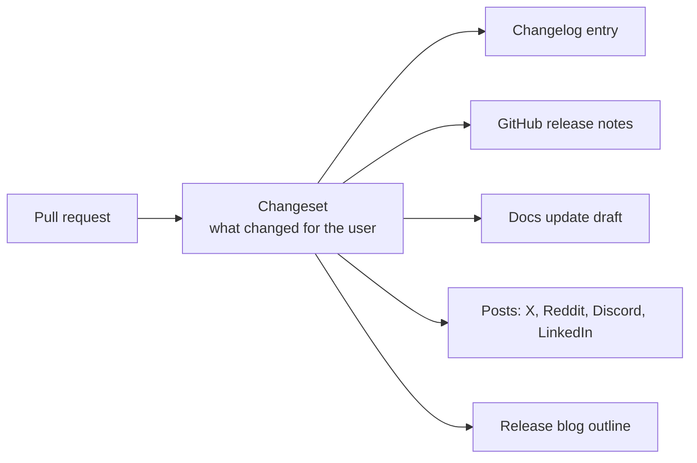

ThinkRail merges dozens of pull requests a week. Docs written by hand from scratch cannot keep that
pace, and stale docs are worse than none. The plan is to automate as much of the writing as possible:
scripts produce everything that can be derived from code, agents draft the rest from structured input,
and people approve rather than write. Human review stays mandatory; in practice it becomes a much
smaller job.

ThinkRail is itself an agentic IDE built spec-first, so this is also the product eating its own
cooking.

## Changesets are the source of every announcement

A changeset is a short, structured note a pull request adds to describe its user-visible effect. Today
the repository uses changesets only for the published `pi` packages; app pull requests are announced
through GitHub's auto-generated list of PR titles. Extending changesets to every user-visible app change
turns one small note per PR into the input for everything downstream:

- **One fact, written once.** The author — or the agent that made the change — states the effect in
  user terms while the context is fresh. Every later artifact is derived, not rewritten.
- **Channel-specific rendering.** The same changeset becomes a terse changelog bullet, a release-notes
  highlight, a tweet thread, a Reddit post with more technical depth, or a section of a release blog
  post. An agent drafts each from a channel template and the voice guide; a person approves.
- **Better than PR titles.** Titles describe the code change (`feat(web): …`); changesets describe what a
  user can now do. The [changelog](../changelog.md) in this draft was reconstructed from PR bodies after
  the fact — with changesets, the same quality comes for free.
- **Routed by area.** Each changeset carries an `area:` field whose value is a docs folder slug
  (`workspaces`, `agent`, `specs`, `review`, `extend`, `security`, `run`), so the drafted docs update
  lands in the area that owns the change and the changelog can group bullets the same way.
- **Enforceable.** CI can require a changeset (or an explicit "no user-visible change" marker) on every
  PR, the same way the repository already enforces spec and boundary rules. The bundled
  `shipping-a-pr` workflow can write the changeset as part of opening the PR.

## Render what is deterministic, then augment

Anything that can be read from the source code should be generated by a script, never typed by a
person or an agent. Reference pages then cannot drift from the product, and AI and humans spend their
effort only on what code cannot say: purpose, context, examples, caveats.

| Reference page | Deterministic source |
| --- | --- |
| [CLI](../reference/cli.md) | the argument parser in `apps/cli/src/args.ts` and the installer scripts |
| [Settings](../reference/settings.md) | the Settings navigation in `apps/web/src/panels/settingsNav.ts` and defaults in `packages/contracts` |
| [Keyboard shortcuts](../reference/keyboard-shortcuts.md) | the shortcut commands in `apps/web/src/shell/` and the desktop menu |
| [Tools the agent can call](../agent/agent-tools.md) | the TypeBox parameter schemas each tool declares, which already convert to JSON Schema |
| [Spec format](../specs/spec-format.md) | the frontmatter schema in `packages/spec-graph` |
| [Files and environment](../reference/files-and-environment.md) | path helpers and every environment variable the host reads |

Each generator renders into the area folder that owns its source (`packages/spec-graph` into `specs/`,
tool schemas into `agent/`) or, for whole-product sources such as the CLI parser and the Settings
navigation, onto the `reference/` shelf.

The pipeline has three stages:

1. **Render.** A script extracts the facts into data — flags, settings with defaults, shortcuts,
   tool parameters — and renders the skeleton of each reference page: tables, names, types, defaults.
2. **Augment.** An agent fills in the prose a schema cannot carry — when to use an option, an example,
   a warning — and links it to the how-to and explanation pages. It never edits the generated facts.
3. **Gate.** A person reviews the diff. Because the facts are machine-checked, review is about whether
   the explanation is right and useful, not about re-checking every default.

A CI check that re-renders the skeletons and fails on any difference turns drift into a build error
instead of a bug report.

## How often docs follow code

The cadence depends on how fast the code moves:

- **Low pull-request flow — update docs in every PR.** The PR that changes behavior also carries its
  changeset and the docs diff, drafted by the agent that made the change and reviewed with the code.
  Docs are never behind.
- **High pull-request flow — snapshot approach.** When per-PR docs updates start slowing down merges,
  docs move to a snapshot model instead.

## What this needs from the project

- Changesets extended from the `pi` packages to user-visible app changes, with a CI check.
- Small extraction scripts for each deterministic reference page, plus a drift check in CI.
- Channel templates and the voice guide from the [authoring guide](authoring-guide.md) available to the
  agents that draft announcements.
- A named human approver for docs and for public posts.
