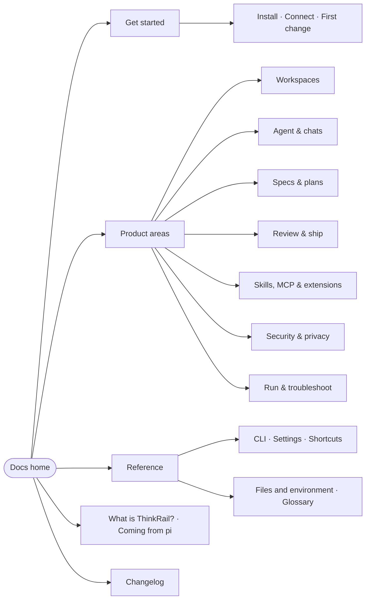

ThinkRail had no documentation beyond its README and the engineering specs in the repository. This
page explains the structure chosen for the first docs set, the reasoning behind it, and the work that
remains before it can ship.

## Who the docs serve

ThinkRail's own product spec names three audiences, and each arrives with a different question:

| Reader | Arrives asking | Lands first on |
| --- | --- | --- |
| **Newcomer to agents or `pi`** | "What is this, and can I get one useful change out of it today?" | [What is ThinkRail?](../what-is-thinkrail.md), [Make your first change](../get-started/first-change.md) |
| **Experienced `pi` user** | "What do I gain over the terminal, and do I keep my skills, extensions, and providers?" | [Coming from pi](../coming-from-pi.md), [ThinkRail and pi](../agent/thinkrail-and-pi.md) |
| **Agent-first builder** | "How do I run several agents in parallel without losing control of what they did?" | [Run agents in parallel](../workspaces/parallel-workspaces.md), [Review changes](../review/review-changes.md) |

Two secondary readers matter too: **contributors** (served by `CONTRIBUTING.md`, `architecture.md`, and
the module specs, which stay in the repository) and **evaluators** — people deciding whether ThinkRail is
safe to point at a real repository. The [Security and data overview](../security/security-and-data-overview.md)
is their entry page.

## Three layers

ThinkRail's surface is wide — an IDE, an agent host, a spec system, workflow skills, MCP, two launchers —
and most of it is new vocabulary. The structure has three layers, each solving a different problem:

- **The front door serves the audiences.** The home page opens with four questions — deciding,
  coming from `pi`, evaluating for a team, something broke — each answered by one page. The home page,
  What is ThinkRail?, and Coming from pi sit at the top of the sidebar as standalone links; the first
  sidebar group, Get started, holds the first-run sequence.
- **The product map is the navigation.** One sidebar group, and one folder, per thing ThinkRail has:
  workspaces, the agent and its chats, specs and plans, review and shipping, skills and MCP, security,
  running the host. A reader opens the box named after what they are working on, and everything about
  one subject sits together.
- **Diátaxis is the page discipline.** Every page is still exactly one of tutorial, how-to, reference,
  or explanation, declared in its `type` frontmatter, and the [authoring guide](authoring-guide.md)
  holds each type to its shape. Inside an area the types set the order: concept first, then tutorials,
  how-tos, and the area's reference.

The first draft used Diátaxis types as the top-level sections. It kept pages focused, but a subject
like specs or security was split across three sections, and readers did not navigate by type. The
structure was chosen after a reader study; see [Reader study](reader-study.md).

## The map

The authoritative order is [`navigation.yml`](../navigation.yml). Each area's folder has the same
slug a changeset's `area:` uses, so automation can place a page without reading the navigation.

## Decisions

- **Areas over types.** Folders and sidebar groups follow the product; `type` stays in frontmatter
  and drives page shape and the type badge, not location.
- **Reference lives with its owner.** A reference page whose source belongs to one area sits in that
  area (Spec format, MCP configuration, Built-in workflows, Tools the agent can call, Platform support).
  Lookups that span the product — CLI, Settings, Keyboard shortcuts, Files and environment, Glossary —
  stay on the Reference shelf.
- **Audience pages, not audience paths.** The front door is four pages and a home-page table, not a
  separate tab or a set of path pages that duplicate the areas.
- **The README stays the front page.** The docs go deeper; they don't replace the README's install
  section or pitch. Install facts live in one place in the docs ([Install](../get-started/install.md)) and
  the README links to it once docs are published.
- **Engineering specs stay in the repository.** `architecture.md`, `goal-and-requirements.md`, and the
  module `SPEC.md` files are written for contributors and agents. The concept pages retell their
  decisions for users and link to them rather than mirroring them.
- **One changelog for humans.** GitHub releases list every PR; the [changelog](../changelog.md) groups
  them by what a user can now do, with a short narrative per release. The nightly line has its own
  "Unreleased" section so nightly users can see what they are testing.
- **Neutral content, swappable platform.** Pages use a portable Markdown subset and a separate
  navigation file (see the [authoring guide](authoring-guide.md)) so the platform decision in
  [Hosting options](hosting-options.md) does not block writing.
- **Status is visible.** Every page declares `complete`, `draft`, or `outline`. The preview renders the
  status so reviewers can see at a glance what is finished.

## What this draft contains

52 pages, about 69,000 words. Every written page was drafted from the source code and checked against
it, not from the UI alone; nothing was verified by running the app end to end yet.

| Area | Pages | Complete | Draft | Outline |
| --- | --- | --- | --- | --- |
| Get started | 5 | 1 | 4 | — |
| Workspaces | 4 | 1 | 3 | — |
| Agent & chats | 5 | 2 | 3 | — |
| Specs & plans | 6 | 3 | 2 | 1 |
| Review & ship | 3 | — | 3 | — |
| Skills, MCP & extensions | 5 | 1 | 4 | — |
| Security & privacy | 5 | 2 | 3 | — |
| Run & troubleshoot | 7 | 2 | 5 | — |
| Reference | 5 | 4 | 1 | — |
| Home, changelog, about | 7 | 2 | 5 | — |

`complete` means every claim on the page was checked against the code. `draft` means the page is fully
written but carries at least one claim, label, or screenshot that needs a maintainer with a running
build — those claims are marked with an "Unverified" warning on the page. `outline` means the page
holds its planned sections only.

## Next steps

The production model behind these steps — changesets as the source of every announcement, generated
reference, and an AI-plus-human review gate — is laid out in [Docs automation](docs-automation.md).

1. **Maintainer review** of every `draft` page against the current nightly — especially the CLI,
   settings, and shortcut reference, which change fastest.
2. **Screenshots** for the tutorials, shot from a clean profile in both themes and stored in
   `docs/assets/` (the README's workbench shots are reused for now).
3. **Reference generation.** CLI flags, settings, keyboard shortcuts, and agent tool parameters can be
   generated from the source so they cannot drift; until then a docs check in CI should at least fail on
   broken links.
4. **Pick the platform** and wire the build into CI with link checking and an `llms.txt` export, so
   agents — including ThinkRail's own — can read the docs.
5. **Close the loop with the product.** Link the in-app "Docs" entry points (the website's
   "Docs — Coming soon" row, Settings help links, error messages) to stable docs URLs.
6. **Short videos** for the two flagship flows — parallel workspaces and review — embedded in the
   matching tutorials.

## Open questions for maintainers

These came up while writing and need someone with a running build or product context:

1. Run the three written tutorials end to end on a clean profile and add the screenshots they call for.
2. Does a workspace settle as merged on its own after a GitHub merge when `gh` is signed in, and what
   happens without `gh`?
3. Do remote-branch workspaces need `gh`, or is `git fetch` enough? Settings → Integrations says `gh`.
4. Where does the desktop app keep its own data on each OS, and how do you uninstall it?
5. Confirm the **Always allow** MCP approval wording and persistence once it reaches a nightly.
6. Confirm the desktop **Cmd/Ctrl+,** Settings shortcut ships in the current nightly.
7. Is the remote-host recipe (`--host` over Tailscale) a supported setup worth documenting, or should
   the page wait for an official profile?
8. Which pages should link from the app itself — error messages, Settings help, the website's
   "Docs — Coming soon" row?

