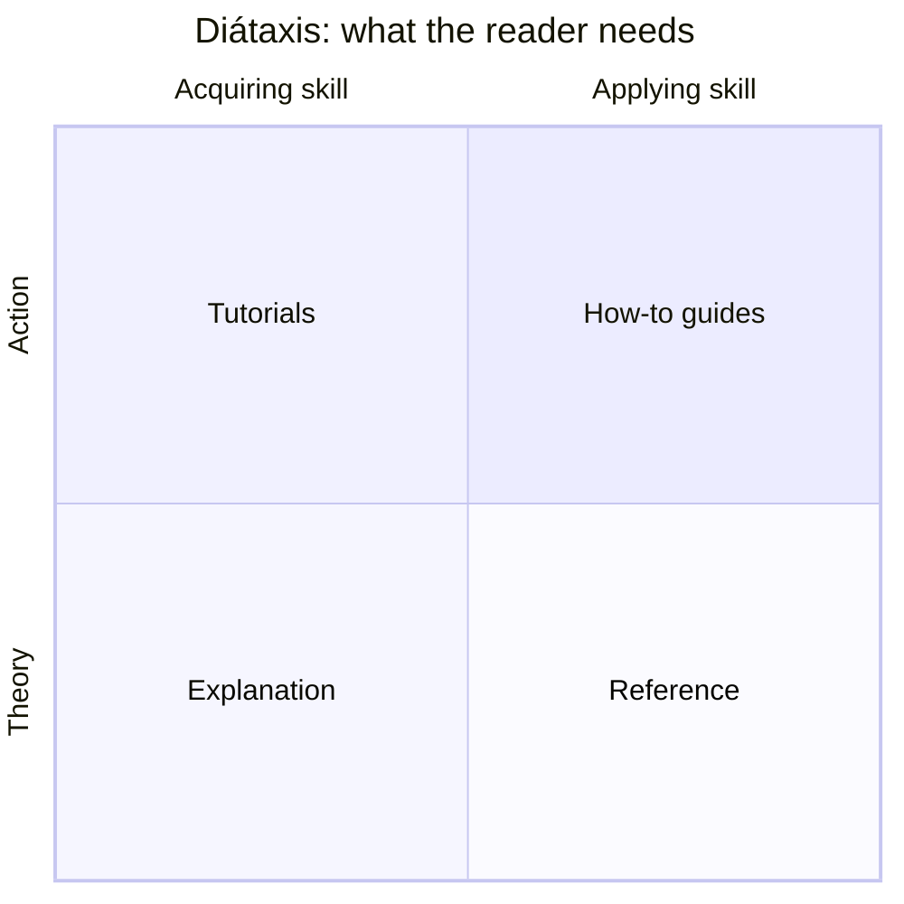
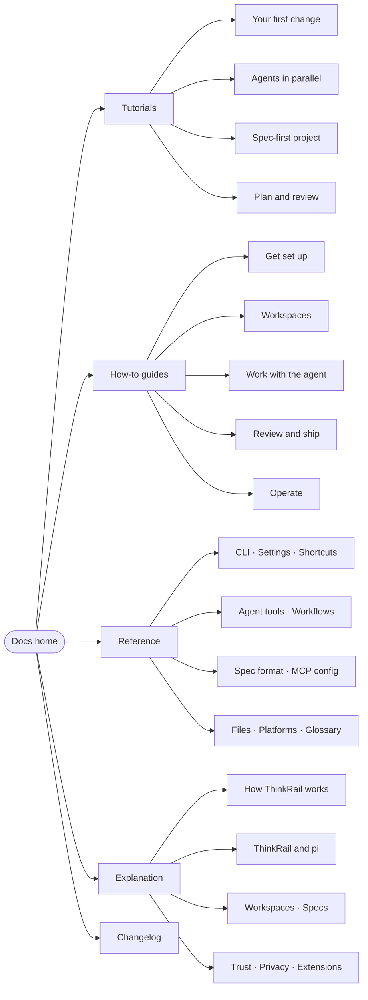

ThinkRail had no documentation beyond its README and the engineering specs in the repository. This
page explains the structure chosen for the first docs set, the reasoning behind it, and the work that
remains before it can ship.

## Who the docs serve

ThinkRail's own product spec names three audiences, and each arrives with a different question:

| Reader | Arrives asking | Lands first on |
| --- | --- | --- |
| **Newcomer to agents or `pi`** | "What is this, and can I get one useful change out of it today?" | [Your first change](../tutorials/first-change.md) |
| **Experienced `pi` user** | "What do I gain over the terminal, and do I keep my skills, extensions, and providers?" | [ThinkRail and pi](../explanation/thinkrail-and-pi.md), [Use your existing skills](../how-to/use-existing-skills.md) |
| **Agent-first builder** | "How do I run several agents in parallel without losing control of what they did?" | [Run agents in parallel](../tutorials/parallel-workspaces.md), [Review changes](../how-to/review-changes.md) |

Two secondary readers matter too: **contributors** (served by `CONTRIBUTING.md`, `architecture.md`, and
the module specs, which stay in the repository) and **evaluators** — people deciding whether ThinkRail is
safe to point at a real repository. The [trust model](../explanation/trust-model.md) and
[privacy](../explanation/privacy-and-analytics.md) pages exist for them.

## Why Diátaxis

ThinkRail's surface is wide — an IDE, an agent host, a spec system, workflow skills, MCP, two launchers —
and most of it is new vocabulary. [Diátaxis](https://diataxis.fr/) keeps that manageable by separating
four needs that otherwise blur into long, unfocused pages:

- **Tutorials** are few and opinionated. Each ends with something real: a merged change, a spec-first
  project, a reviewed plan.
- **How-to guides** are the bulk of the docs and map to the questions users actually ask in issues and
  chat ("how do I connect MCP servers?", "how do I run it on my devbox?").
- **Reference** is generated from, or checked against, the code: CLI flags, settings, shortcuts, agent
  tools, the spec format, files on disk.
- **Explanation** carries ThinkRail's ideas — isolation, living specs, the `pi` relationship, explicit
  trust. This is where the product's point of view lives, and it is the section most worth reading for
  someone deciding whether ThinkRail fits how they work.

## The map

The authoritative order is [`navigation.yml`](../navigation.yml). How-to guides are grouped by the
stage of work — set up, isolate, drive the agent, review and ship, operate — because that is the order
in which a new user meets the problems.

## Decisions

- **The README stays the front page.** The docs go deeper; they don't replace the README's install
  section or pitch. Install facts live in one place in the docs ([Install](../how-to/install.md)) and the
  README links to it once docs are published.
- **Engineering specs stay in the repository.** `architecture.md`, `goal-and-requirements.md`, and the
  module `SPEC.md` files are written for contributors and agents. The Explanation section retells their
  decisions for users and links to them rather than mirroring them.
- **One changelog for humans.** GitHub releases list every PR; the [changelog](../changelog.md) groups
  them by what a user can now do, with a short narrative per release. The nightly line has its own
  "Unreleased" section so nightly users can see what they are testing.
- **Neutral content, swappable platform.** Pages use a portable Markdown subset and a separate
  navigation file (see the [authoring guide](authoring-guide.md)) so the platform decision in
  [Hosting options](hosting-options.md) does not block writing.
- **Status is visible.** Every page declares `complete`, `draft`, or `outline`. The preview renders the
  status so reviewers can see at a glance what is finished.

## What this draft contains

44 pages, about 55,000 words. Every page was written from the source code and checked against it, not
from the UI alone; nothing was verified by running the app end to end yet.

| Section | Pages | Complete | Draft | Outline |
| --- | --- | --- | --- | --- |
| Tutorials | 4 | — | 3 | 1 |
| How-to guides | 18 | 2 | 16 | — |
| Reference | 10 | 9 | 1 | — |
| Explanation | 7 | 5 | 2 | — |
| Home, changelog, about | 5 | 1 | 4 | — |

`complete` means every claim on the page was checked against the code. `draft` means the page is fully
written but carries at least one claim, label, or screenshot that needs a maintainer with a running
build — those claims are marked with an "Unverified" warning on the page.

## Next steps

1. **Maintainer review** of every `draft` page against the current nightly — especially the CLI,
   settings, and shortcut reference, which change fastest.
2. **Screenshots** for the tutorials, shot from a clean profile in both themes and stored in
   `docs/assets/` (the README's workbench shots are reused for now).
3. **Reference generation.** CLI flags, settings, keyboard shortcuts, and agent tool parameters can be
   generated from the source so they cannot drift; until then a docs check in CI should at least fail on
   broken links.
4. **Pick the platform** and wire the build into CI with link checking and an `llms.txt` export, so
   agents — including ThinkRail's own — can read the docs.
5. **Close the loop with the product.** Link the in-app "Docs" entry points (the website's
   "Docs — Coming soon" row, Settings help links, error messages) to stable docs URLs.
6. **Short videos** for the two flagship flows — parallel workspaces and review — embedded in the
   matching tutorials.

## Open questions for maintainers

These came up while writing and need someone with a running build or product context:

1. Run the three written tutorials end to end on a clean profile and add the screenshots they call for.
2. Does a workspace settle as merged on its own after a GitHub merge when `gh` is signed in, and what
   happens without `gh`?
3. Do remote-branch workspaces need `gh`, or is `git fetch` enough? Settings → Integrations says `gh`.
4. Where does the desktop app keep its own data on each OS, and how do you uninstall it?
5. Confirm the **Always allow** MCP approval wording and persistence once it reaches a nightly.
6. Confirm the desktop **Cmd/Ctrl+,** Settings shortcut ships in the current nightly.
7. Is the remote-host recipe (`--host` over Tailscale) a supported setup worth documenting, or should
   the page wait for an official profile?
8. Which pages should link from the app itself — error messages, Settings help, the website's
   "Docs — Coming soon" row?

