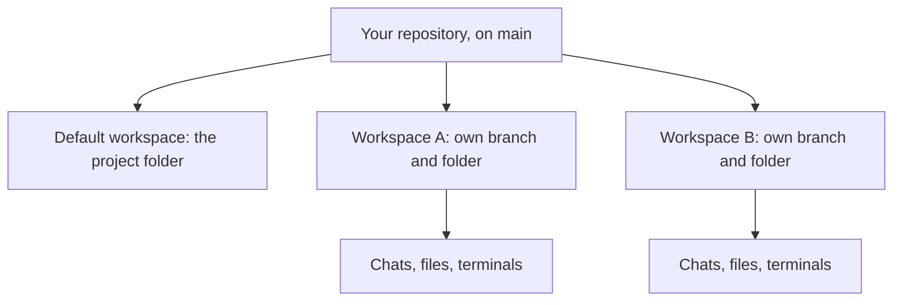

A workspace is where one piece of agent work happens: its own branch, its own folder, and its own chats,
files, and terminals. ThinkRail creates workspaces as `git worktree`s so agents can work in parallel
without touching your checkout. This page explains that choice, the two exceptions to it, and what it
costs.

## The problem with one working tree

An agent working directly in your project folder changes the branch you have checked out, immediately.
That is simple, and it is fragile:

- **Your edits are in the blast radius.** An agent can overwrite a file you have open, and a git
  operation it runs can discard work you have not committed.
- **Parallel agents collide.** Two agents in one folder edit the same files, fight over the index, and
  switch branches under each other.
- **Review gets muddy.** When your edits and the agent's share one diff, it is hard to see what the agent
  did.

## A workspace is a worktree

When you create an isolated workspace, ThinkRail runs `git worktree add` to cut a new branch from the
base you pick and check it out in its own folder under `~/.thinkrail/worktrees/<project-slug>/<branch>`.
Everything in the workspace — chats, the file tree, the Changes view, terminals — is scoped to that
folder.

Because a worktree is plain git, nothing about it is ThinkRail-specific. The branch is a normal branch,
the folder is a normal checkout, and your own tools work on it. You can
[open the worktree in your editor](../how-to/open-in-your-editor.md), run `git` in its terminal, or push
the branch and [open a pull request](../how-to/open-a-pull-request.md) from ThinkRail. Your base branch
does not change until you merge.

A few details keep the worktree honest:

- **The branch does not track its base.** ThinkRail creates it with `--no-track`, so `git push` in the
  workspace terminal never targets the base branch by accident. You set the upstream on first push.
- **Name and branch are separate.** A workspace's display name can be anything; its branch is a short
  slug. The agent may name both once it understands the task, but a name you type always wins.
- **The folder never moves.** Renaming a workspace changes its label, not its path, because `pi` keys
  sessions and terminals by working directory.

## The Default workspace is an explicit choice

Every project also has exactly one **Default workspace**, whose folder is the project folder itself.
It exists for the times you want an agent in your real checkout — a quick fix on the current branch, or
work that needs untracked files only your checkout has.

ThinkRail never puts you there automatically. You choose **Work in project folder**, and the UI says
what that means: no isolation, and changes land on the current branch. The Default workspace cannot be
renamed, removed, or settled, and its branch label follows whatever you check out in a terminal.

## Attached worktrees

If you already manage worktrees yourself, you can attach one in place with **Open existing worktree…**.
ThinkRail uses its folder and branch but never creates, renames, or deletes anything in it. Removing an
attached worktree from ThinkRail forgets its chats and terminals and leaves the checkout and branch
alone.

## Parallel agents

Isolation is what makes parallel work cheap. Cut two workspaces from the same branch, give each a task,
and let both agents run. Each sees only its own folder and branch, so neither waits for nor breaks the
other. When both finish, you review each diff on its own and keep the work you want. Within one
workspace you can also run several chats and [delegate to subagents](../how-to/delegate-to-subagents.md);
those share the workspace folder, so isolation between them is up to how you split the task.

The [parallel workspaces tutorial](../tutorials/parallel-workspaces.md) walks through this end to end.

## The Settled shelf

Workspaces pile up. Instead of asking you to clean up, ThinkRail moves quiet ones onto a per-project
**Settled** shelf and brings them back when you work in them again. Settling changes only the list;
nothing on disk moves.

| A workspace settles when | A workspace stays live while |
| --- | --- |
| Its pull request merges or closes | Its pull request is open |
| It sees no chat, terminal command, or commit for the idle window — 7 days by default | An agent is running in it |
| You choose **Settle** | It has a result you have not read |

Real work — a chat, a terminal command, a commit — brings a settled workspace back on its own, and
**Keep active** pins it live. You set the idle window in **Settings → Workspaces**, from one day to
**Never**. With **Never**, only a merged or closed pull request or your own **Settle** moves a workspace.

The design choice here is that the shelf is derived, not stored: the host records facts such as last
activity and the pull request's state, and each client computes which rows are live. So the rules can
never disagree with a stale flag. See [Manage workspaces](../how-to/manage-workspaces.md).

## Removing a workspace

Removing an isolated workspace deletes its chats, terminals, and worktree folder, including any
uncommitted changes in it. The branch is kept, so committed work survives and you can check it out
again later. Commit or push anything you want to keep first.

## Trade-offs

Worktrees are the right default for agent work, and they are not free:

- **Disk space.** Every worktree is a full checkout of your tracked files. Git shares the object store,
  but large repositories multiply on disk.
- **Untracked files do not come along.** A new worktree has no installed dependencies, build output,
  or local `.env` files, because git does not track them. Expect to install dependencies per workspace,
  or have the agent do it.
- **Your editor shows the original checkout.** Changes live in the worktree folder, not in the project
  folder you have open elsewhere, until you merge.
- **Isolation is about git state, not security.** A workspace keeps agents out of each other's files and
  out of your checkout. It is not a sandbox: the agent's commands run as your user, with your
  permissions, anywhere on the machine. The [trust model](trust-model.md) covers what that means.

## Related

- [Manage workspaces](../how-to/manage-workspaces.md)
- [Review changes](../how-to/review-changes.md)
- [Glossary](../reference/glossary.md) — project, workspace, Default workspace
