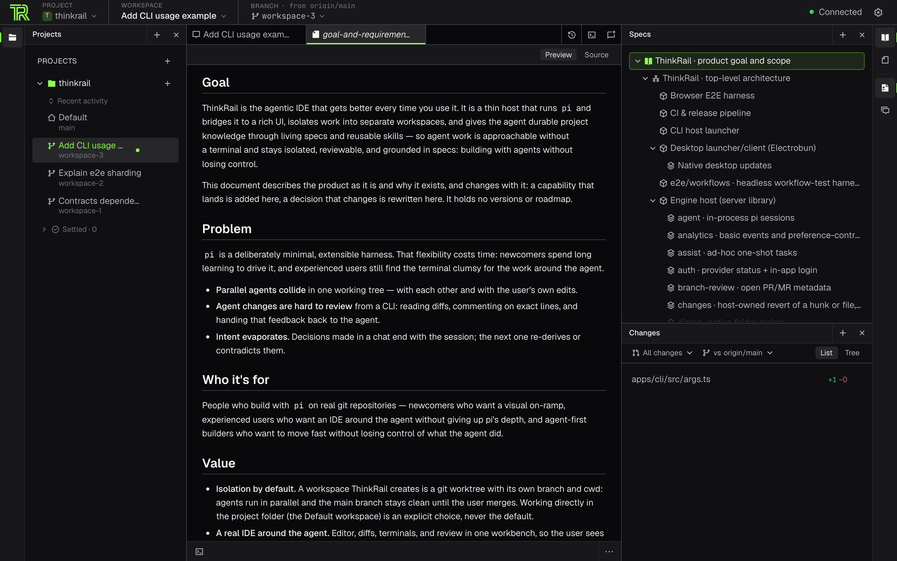

ThinkRail is a free, open-source workbench for coding agents. Every task gets its own git worktree,
you review the agent's work as diffs before anything ships, and your project's intent lives in specs
the agent reads and keeps current. The agent inside is [`pi`](https://pi.dev), an open-source coding
agent that owns models, skills, and sessions, so a `pi` setup you already have keeps working.

## Where are you starting?

| If you are… | Start with |
| --- | --- |
| Deciding whether ThinkRail is for you | [What is ThinkRail?](what-is-thinkrail.md) |
| Coming from `pi` in the terminal | [Coming from pi](coming-from-pi.md) |
| Evaluating ThinkRail for a team | [Security and data overview](security/security-and-data-overview.md) |
| Stuck because something broke | [Troubleshoot ThinkRail](run/troubleshoot.md), and the [changelog](changelog.md) for what changed |

## Start here

Install ThinkRail, connect a model provider, and ship one reviewed change in about 20 minutes:

1. [Install ThinkRail](get-started/install.md) — the desktop app or the `thinkrail` CLI.
2. [Connect a model provider](get-started/connect-a-provider.md) — JetBrains AI, a subscription
   sign-in, or your own API keys.
3. [Make your first change](get-started/first-change.md) — from an empty workspace to a pull request.

## The map

The sidebar follows the product. Each area opens with the idea behind it, then the guides, then its
reference.

| Area | What it covers |
| --- | --- |
| [Workspaces](workspaces/workspaces-and-isolation.md) | Projects, workspaces, git worktrees and branches, parallel agents, your editor |
| [Agent & chats](agent/thinkrail-and-pi.md) | `pi`, chats and sessions, models and effort, steering, follow-ups, subagents, agent tools |
| [Specs & plans](specs/living-specs.md) | Living specs, `SPEC.md` files, plans and TODO lists, built-in workflows |
| [Review & ship](review/review-changes.md) | Diffs, review comments, undo and discard, pull requests |
| [Skills, MCP & extensions](extend/extensions.md) | Skills, prompt templates, MCP servers, extensions, ThinkRail packages in `pi` |
| [Security & privacy](security/security-and-data-overview.md) | What leaves your machine, project trust, permissions, telemetry |
| [Run & troubleshoot](run/troubleshoot.md) | Fixes, updates, backup, remote machines and SSH, building from source, platforms |
| [Reference](reference/cli.md) | CLI flags, settings, keyboard shortcuts, files and environment variables, glossary |
| [Changelog](changelog.md) | What changed in each release, stable and nightly |

## Get help

- Report bugs and request features in [GitHub issues](https://github.com/JetBrains/thinkrail/issues).
- Read the source and the engineering specs on [GitHub](https://github.com/JetBrains/thinkrail).
- Follow releases on the [ThinkRail blog](https://thinkrail.ai/blog/) and in the
  [changelog](changelog.md).

ThinkRail is open source under the Apache License 2.0 and is a JetBrains incubator project.
