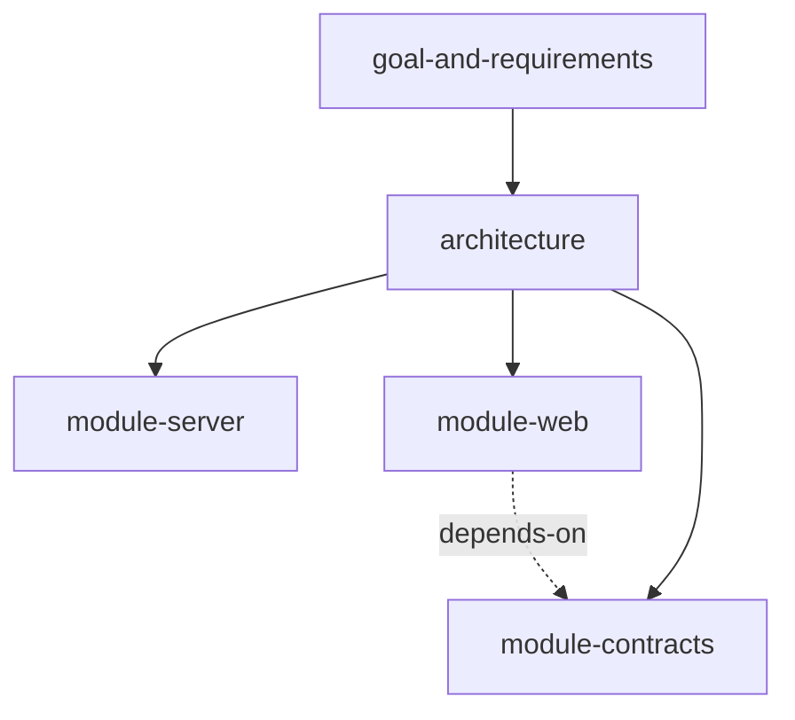

A spec is a Markdown file with a YAML frontmatter block that gives it an `id` and a `type`. Specs link to
each other through frontmatter fields, and the links form a graph that the agent and the **Specs** tool
read. This page defines the format. For why specs exist and how the agent uses them, read
[Living specs](../explanation/living-specs.md).

## What makes a file a spec

A file is a spec when all of these hold:

- Its name ends in `.md`. Any `.md` file under the project root qualifies; the name `SPEC.md` is a
  convention, not a requirement.
- It starts with a frontmatter block: a line containing only `---`, YAML, and a second line containing
  only `---`. A leading byte order mark and Windows line endings are accepted.
- The frontmatter parses as YAML and has a non-empty `id` and a non-empty `type`.

A Markdown file without both fields, with malformed YAML, or without frontmatter is not a spec and is
ignored. No other check applies: a file does not need a `title` to be indexed, although `spec_create`
requires one and the bundled `spec-graph` skill treats it as required.

## Frontmatter fields

| Field | Type | Required | Description |
| --- | --- | --- | --- |
| `id` | string | yes | Unique slug that names the spec. Other specs link to it by this value. It cannot be renamed with `spec_update`. |
| `type` | string | yes | What kind of spec this is. See [Types](#types). |
| `title` | string | no, but expected | Human-readable title. The **Specs** tool shows the `id` when it is missing. `spec_create` requires it. |
| `status` | string | no | Lifecycle state. See [Statuses](#statuses). |
| `parent` | string | no | One spec id. The tree edge; mirrors the code hierarchy. |
| `depends-on` | list of strings | no | Spec ids this spec depends on. |
| `references` | list of strings | no | Spec ids this spec cites without depending on. |
| `implements` | list of strings | no | Spec ids this spec implements. |
| `covers` | list of strings | no | Free-form coverage ids or topics. Not links; they are not resolved. |
| `tags` | list of strings | no | Free-form tags. Filterable with `spec_grep`. |

`spec_create` writes new frontmatter in this order: `id`, `type`, `status`, `title`, `parent`,
`depends-on`, `references`, `implements`, `covers`, `tags`. `spec_update` keeps the order a file already
has. Tools write lists inline, as `[a, b]`; block-style YAML lists are read normally. Unknown extra fields
are allowed and preserved.

### Types

The `type` value is a free string in the read model: the graph indexes whatever is on disk. The
authoring tools (`spec_create`) accept five values:

| `type` | Used for | Scaffold headings from `spec_create` |
| --- | --- | --- |
| `goal-and-requirements` | The product goal and scope; the root of the graph. | Goal, Scope |
| `architecture-design` | System-wide topology, cross-cutting decisions, and invariants. | Drivers, Decisions, Invariants, Out of scope |
| `module-design` | A package or module: its responsibility and boundary. | Responsibility, Boundary |
| `submodule-design` | The same, for a directory-level module inside a package. | Responsibility, Boundary |
| `task-spec` | A temporary working document for one piece of work. Not durable; deleted when the work lands. | Purpose, Open items |

A spec of any other `type` still appears in the graph. The **Specs** tool labels it with an uppercase tag
derived from its `type`.

### Statuses

`status` is optional and tracks a spec's lifecycle. `spec_create` accepts these values:

| `status` | Meaning |
| --- | --- |
| `draft` | Being written; not yet reviewed. Workflows create specs as `draft`. |
| `active` | In force. |
| `stale` | Drifting from the code. |
| `done` | Finished; used mainly by task-specs. |
| `deprecated` | No longer in force. |

The usual path is `draft` to `active`, then `stale`, `done`, or `deprecated`. `spec_update` does not check
`status` or `type` values against these lists, so a typo is stored as written.

## Example

A module spec, as `spec_create` and the bundled workflows write them:

```markdown
---
id: module-billing
type: module-design
status: active
title: Billing service
parent: architecture
depends-on: [module-contracts]
references: [adr-invoice-numbering]
tags: [billing]
---

## Responsibility

Issues invoices and records payments. It owns the invoice number sequence.

## Boundary

- **Allowed dependencies:** `module-contracts`, the database client.
- **Forbidden:** importing from the web app.
```

The body is ordinary Markdown. Spec tools never edit it.

## File placement

| File | Location | Type |
| --- | --- | --- |
| Product goal | `goal-and-requirements.md` at the project root | `goal-and-requirements` |
| Architecture | `architecture.md` at the project root | `architecture-design` |
| Module spec | `SPEC.md` beside the module's code, for example `packages/server/SPEC.md` | `module-design` |
| Sub-module spec | `SPEC.md` beside a meaningful directory inside a module | `submodule-design` |
| Task-spec | `.thinkrail/context/TASK-<slug>.md` in the workspace | `task-spec` |

The layout is fractal: a package and its sub-directories each have a `SPEC.md`. Task-specs live in the
workspace's gitignored `.thinkrail/context/` folder. Existing design documents can join the graph in place
by gaining frontmatter, with no change to their content.

## How the graph is built

Every spec is a node keyed by its `id`. Four frontmatter fields create edges from the spec that declares
them to the spec they name:

| Field | Edge | Shape | Typical use |
| --- | --- | --- | --- |
| `parent` | tree edge | one id | A module's spec points at its package's spec, which points at `architecture`, which points at the goal. |
| `depends-on` | dependency | list | The module may rely on the target; mirrors an allowed import or contract. |
| `references` | reference | list | The spec cites the target without depending on it. |
| `implements` | implementation | list | The spec describes an implementation of the target. |

`parent` edges form the hierarchy. The other three form a dependency layer across that tree. Each edge also
gets a derived reverse edge, so `spec_get` can report which specs point at a given spec. The tools do not
treat the three list fields differently from one another; the distinction is for readers and for the
filters on `spec_grep` and `spec_graph`.



`covers` and `tags` are metadata, not edges.

### Duplicate ids and broken links

- If two files declare the same `id`, the file that sorts first by path wins the node and the other is
  reported as a duplicate. Files are visited in name order, comparing Unicode-normalized names, so the
  winner is the same on every filesystem.
- A link whose target id does not exist stays in the graph as a missing target; it does not stop the other
  specs from loading.
- `spec_validate` reports dangling links in all four link fields, duplicate ids, and cycles in the `parent`
  chain. It does not check cycles in `depends-on`, `references`, or `implements`.

## `[[wikilinks]]`

ThinkRail's own specs cite other specs in prose as `[[spec-id]]`. That is a writing convention for human
readers and agents. No tool parses or resolves it, and the **Specs** tool renders it as plain text. The
only links in the graph are the frontmatter fields above.

## Spec tooling limits

- **Which files are scanned.** The scan starts at the workspace root and skips directories named
  `node_modules`, `.git`, `dist`, `build`, `.claude`, `.superpowers`, `.gsd`, `.mockups`, and
  `.playwright-mcp`. The last five hold other assistants' scratch files that can carry spec-shaped
  frontmatter. Symbolic links are never followed. Only files ending in lowercase `.md` are read.
- **`spec_create` path rules.** The path must be relative to the project root, end in `.md`, stay inside the
  root, avoid the skipped directories, and pass through no symbolic link. Windows drive letters and stream
  syntax (a colon in the path) are refused. Names that differ only by case or Unicode form are resolved
  to the spelling already on disk, and ambiguous matches are refused. The call fails if the file or the id
  already exists.
- **Read model.** The graph reads frontmatter values as strings or lists of strings. Numbers and booleans
  become strings, empty values are dropped, nested maps are ignored for the graph, and a single string where a
  list is expected is read as a one-item list.
- **Write model.** `spec_update` rewrites only the frontmatter block, in the line ending the block already
  used, and keeps comments, field order, and unknown or nested fields. It cannot edit prose, rename an
  `id`, remove `id` or `type`, or turn a file into a non-spec. There is no tool to move or rename a spec
  file.
- **Search.** `spec_grep` matches one line at a time, as a substring or a JavaScript regular expression,
  across spec files only, and returns at most 200 matches by default. There is no semantic or embedding
  search.
- **Freshness.** Each call checks file modification time and size, so edits from any source are picked up on
  the next call. An edit that keeps both the same size and the same timestamp tick would be missed.
- **One graph per workspace.** The index is built from the workspace root. Another workspace on a different
  branch has its own graph.
- **Read-only viewer.** The **Specs** tool shows the `parent` hierarchy as a tree, sorted by title within each
  level. There is no spec editor in the app; specs change through the agent, your editor, or the terminal.

## Related

- [Agent tools](agent-tools.md#spec-graph-tools)
- [Workflows](workflows.md)
- [Living specs](../explanation/living-specs.md)
- [Set up a project for spec-first work](../tutorials/spec-first-project.md)
