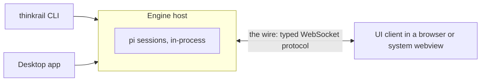
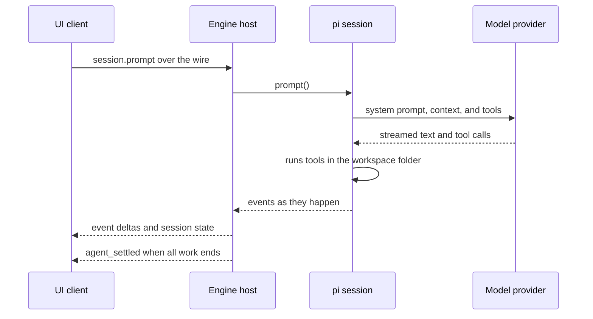

ThinkRail is a thin host that runs the `pi` coding agent inside its own process and bridges it to a
rich UI. This page explains how the pieces fit, what happens when you send a message, and where each
kind of state lives on disk.

## Three rings

ThinkRail is built as three rings with one rule between them: the UI never reaches into the host, and
the host never assumes which UI is talking to it.

| Ring | Code | Owns |
| --- | --- | --- |
| **Engine host** | `packages/server` + `packages/shared` | `pi` sessions, projects and workspaces, git, terminals, persistence under `~/.thinkrail`, and the HTTP and WebSocket endpoint |
| **The wire** | `packages/contracts` | The typed, versioned protocol — the only coupling between host and UI |
| **UI client** | `apps/web` | Panels, the workbench layout, and everything you see; it depends on the contracts, never on host code |

The split exists so the UI can ship as static files independent of the host. The wire carries a
protocol version in its first message, `server.welcome`, so a UI that is newer or older than the host
can tell, and hides controls for features the host does not support yet.

## Two launchers, one app

You start ThinkRail in one of two ways, and both run the same host code:

- **The `thinkrail` CLI** boots the host in its own process, serves the UI on `localhost:24242` (or the
  next free port), and opens your default browser.
- **The desktop app** embeds the same host in its process on a random loopback port and shows the same
  UI in a native system webview. It never spawns the CLI.

Launchers own startup, shutdown, windows, and packaging — nothing else. A feature changes the contract,
the host module that owns it, and the shared UI, so it behaves the same in both. Choosing between them is
a matter of taste: a window you click, or a command you type. See [Install ThinkRail](../get-started/install.md)
and the [CLI reference](../reference/cli.md).

> [!NOTE]
> The two launchers do not lock each other out. If you run the desktop app and a CLI host at the same
> time, both read and write `~/.thinkrail`, and concurrent changes can overwrite each other. Run one host
> per data directory.

## pi runs inside the host

The host creates each chat as an in-process `pi` session through the
[`@earendil-works/pi-coding-agent`](https://www.npmjs.com/package/@earendil-works/pi-coding-agent) SDK.
There is no subprocess, no RPC bridge, and no second agent runtime. One chat is one `pi` session, and
the chat's id is the session's id.

Running in-process keeps the bridge thin: the host reads `pi`'s state and forwards `pi`'s events without
translating between two processes. The cost is crash isolation. A fatal fault inside `pi` or an extension
takes the whole host down with it, and you restart the host. That trade-off is deliberate;
[ThinkRail and pi](../agent/thinkrail-and-pi.md) explains why.

## What happens when you send a message

1. **The UI sends a request.** If the chat is idle, the composer sends a prompt. If the agent is already
   running, the message goes in as a steer or a follow-up instead — `pi` does not accept a second prompt
   mid-run. See [Steer a run or queue a follow-up](../agent/steer-and-queue.md).
2. **`pi` does the agent work.** It builds the system prompt from its skills and extensions, calls your
   model provider with your credentials, and runs tools — shell commands, file edits, `spec_*` lookups —
   with the workspace folder as its working directory.
3. **The host forwards events.** Text and thinking stream in as deltas the UI appends; a running tool's
   partial output replaces the previous snapshot. The host also projects a small, normalized session state
   — running or idle, waiting for your input, queued messages, unread result — that every client shares.
4. **The run settles.** A run can retry, compact its context, or pick up queued follow-ups after a single
   model attempt ends. The host marks the chat idle only when `pi` reports that all of that work is done
   (`agent_settled`). `pi` writes the transcript to its own session file as it goes.

## Where state lives

| State | Where | Owner |
| --- | --- | --- |
| Projects, workspace records, app settings, terminal tabs, read receipts | JSON files under `~/.thinkrail` | Host |
| Workspace checkouts | `~/.thinkrail/worktrees/<project-slug>/<branch>` | Host creates, git manages |
| Chat transcripts | `pi` session files under `pi`'s agent directory (`~/.pi/agent/sessions`) | `pi` |
| Provider credentials, models, MCP configuration | `pi`'s agent directory (`~/.pi/agent`) | `pi` |
| Task notes, plans, and PR drafts for one workspace | `.thinkrail/context/` inside the workspace, ignored by git | Agent and host |
| Workbench layout, open tabs, current location | Local storage of each browser tab or desktop window | That window |

Two consequences follow. Because transcripts are `pi`'s own files, a session you start in ThinkRail can
be continued in the `pi` CLI and the other way round. Because layout is per window, rearranging panels in
one window never moves them in another. The full list of files and environment variables is in
[Files and environment](../reference/files-and-environment.md).

## Every client rebuilds the same view

A client never depends on having watched events arrive. When it connects, it reads the current
projects, workspaces, chats, and transcripts from the host, then subscribes to live changes. A page
reload, a second browser tab, or a host restart therefore rebuilds the same domain state. Terminals
follow the same idea: a shell belongs to its tab on the host, so it survives a reload or a different
browser. A host restart cannot keep shells alive, so tabs come back with fresh shells showing their
recorded output.

## Using the UI from another machine

The UI dials the host it was served from, and the host can bind to an address other than `localhost`
with `--host`. That makes it possible to run the host on one machine and open the UI in a browser on
another — the updater, for example, can update a CLI host from a browser on a different machine. The
desktop app binds loopback only and cannot be reached this way.

> [!WARNING]
> ThinkRail has no login. Anything that can reach the host's port can drive its agent, terminals, and
> files with your user's permissions. The design assumes the network decides who gets in, such as a
> Tailscale tailnet with access controls. Remote use is not yet documented end to end; read
> [Run ThinkRail on a remote machine](run-on-a-remote-machine.md) and the
> [trust model](../security/trust-model.md) before you bind beyond `localhost`.

## Related

- [ThinkRail and pi](../agent/thinkrail-and-pi.md) — what each side owns
- [Workspaces and isolation](../workspaces/workspaces-and-isolation.md) — why every workspace is a git worktree
- [Glossary](../reference/glossary.md) — host, wire, workspace, chat, and other terms
