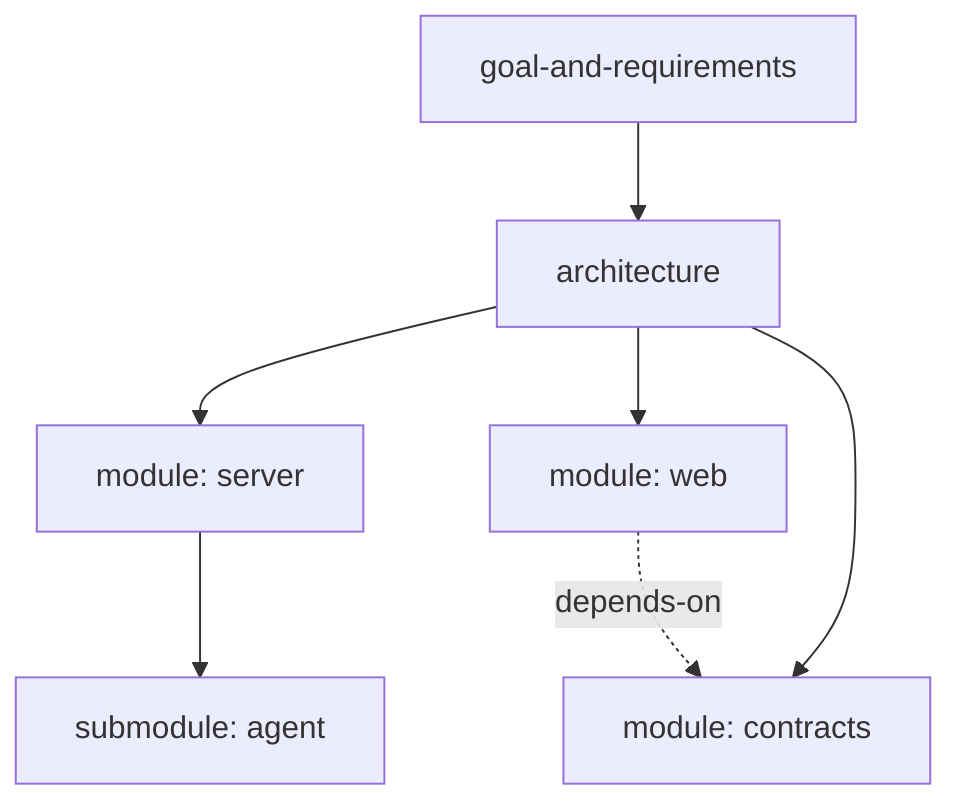

A chat ends and its decisions end with it — unless they are written down where the next chat will find
them. ThinkRail keeps a project's intent in a graph of Markdown specs beside the code, and gives the agent
tools to search, read, and update that graph as part of its normal work. This page explains why, and how
the pieces fit.

## Why specs

Agents make documentation matter again. A model can read code, but code shows what the system does, not
why: which boundaries are deliberate, which trade-offs were chosen, which alternatives were rejected.
Without that, every new session re-derives intent from the code or contradicts a decision made last week.

Specs are ThinkRail's answer. A spec is a short, durable document that states intent — what a module is
for, what it owns, what it must never depend on, and why the non-obvious decisions were made. When specs
are the ground truth, a change that contradicts one is either wrong or a decision to change the spec, and
the agent is told to surface which before it diverges.

The word "living" carries the second half of the idea: specs change in the same change as the code. A
spec that drifts from the code stops being ground truth, so keeping it current is part of finishing the
work, not a separate documentation chore.

## What a spec is

A spec is any Markdown file whose YAML frontmatter has an `id` and a `type`. The conventional layout is
fractal:

- **Root documents** at the repository root — `goal-and-requirements.md` for the product goal and scope,
  `architecture.md` for topology, cross-cutting decisions, and invariants.
- **A `SPEC.md` beside each module**, and beside each meaningful sub-module inside it.
- **Task-specs**, temporary working documents for one piece of work, kept in the workspace's gitignored
  `.thinkrail/context/` folder and deleted once the work lands.

A spec states the world as it is. It is not a plan, a task list, or a changelog, and it does not restate
the code — the reader can see the files; the spec exists for what the files do not say. The fields,
types, and statuses are in the [spec format reference](spec-format.md).

## The spec graph

Frontmatter links turn the files into a graph:

- **`parent`** forms a tree that mirrors the code: a module's spec points at its package's spec, which
  points at the architecture, which points at the goal.
- **`depends-on`, `references`, and `implements`** form a dependency layer across that tree.

The graph is what keeps context small. The agent does not read every spec before every change. It reads
the spec closest to the code it touches, follows links outward when the work crosses a boundary, and
searches the rest only when it needs to. Localized work — a typo, a contained fix — can skip specs
entirely. The specs act as guardrails: present when the work approaches a decision, out of the way when
it does not.

## How the agent uses specs

ThinkRail bundles a `pi` package, `pi-spec-graph`, into every chat. It gives the agent three things:

- **An always-on rule.** Consult the owning spec when work is governed by, or may alter, a documented
  boundary, contract, invariant, behavior, or architecture decision. Keep lookup proportional otherwise.
- **A skill** that teaches the schema and the working loop: orient in the graph, align the change with
  what the specs record, update the specs the change affects, and validate.
- **Seven `spec_*` tools** for that loop.

| Tools | Purpose |
| --- | --- |
| `spec_grep`, `spec_get`, `spec_graph` | Search spec content, read one spec's frontmatter and resolved links, walk a bounded slice of the graph |
| `spec_create`, `spec_update`, `spec_delete` | Scaffold a new spec, edit frontmatter and links in place, remove a spec |
| `spec_validate` | Report dangling links, duplicate ids, and parent cycles |

The tools own structure; none of them edit prose. The agent writes spec bodies with `pi`'s normal file
tools, so a spec edit shows up in the Changes view like any other edit, and you review it the same way.
The graph is refreshed from disk on every call, so specs you edit by hand are always current. Full tool
parameters are in [Tools the agent can call](../agent/agent-tools.md).

You see the same graph in the read-only **Specs** tool, which renders it as a tree beside your code.

## Spec-first in practice

ThinkRail is built spec-first, and its bundled workflows help your projects work the same way:

- **Starting out.** When a project has no specs, its Welcome screen offers **Set up project**. That
  starts a workspace running the project-setup workflow: for a new idea, the agent interviews you and
  drafts the goal document; for an existing codebase, it reads what is there first — agent files, docs,
  manifests — asks only about the gaps, and drafts the goal, the architecture, and one spec per module.
  Existing design documents can join the graph in place by gaining frontmatter.
- **Every change after that.** Feature work, behavior changes, and bug fixes route through a design
  workflow that orients in the graph before building and amends the affected specs, top-down, after the
  change is verified.
- **Review.** Specs are drafted and amended on the workspace branch, so you review them in Changes
  alongside the code and nothing reaches your base branch until you merge.

The [spec-first project tutorial](spec-first-project.md) walks through setup, and
[Built-in workflows](workflows.md) lists each workflow and its steps.

## Specs and AGENTS.md

`AGENTS.md` and specs do different jobs. `AGENTS.md` is a standing instruction file the agent reads for
every task: conventions, commands, rules of the road. Specs are the map of the system that the agent
consults when the work calls for it. A good `AGENTS.md` is short and points at the specs — "this project
is spec-driven; start at `goal-and-requirements.md` and `architecture.md`, then the nearest `SPEC.md`" —
rather than duplicating them.

You do not need an `AGENTS.md` for the spec tools to work: the always-on rule ships with the bundled
package. An `AGENTS.md` section is still the portable way to tell any agent, in any tool, that your
project is spec-driven.

## What specs are not

- **Not generated from code.** A spec records intent the code cannot show; deriving it from the code
  would only restate the code.
- **Not a plan.** Plans and task notes live in the chat's TODO plan and in task-specs, both temporary.
- **Not linked by wikilinks.** You will see `[[spec-id]]` in ThinkRail's own specs. That is a prose
  convention for citing another spec by its `id`. The spec tools do not parse it; the only links in the
  graph are the frontmatter fields.
- **Not semantic search.** `spec_grep` matches text and metadata. There are no embeddings.
- **Not free.** Specs take effort to keep honest, and stale specs mislead. The bet is that a few short,
  current documents cost less than an agent re-deriving intent in every session.

## Related

- [Spec format](spec-format.md)
- [Built-in workflows](workflows.md)
- [Set up a project for spec-first work](spec-first-project.md)
