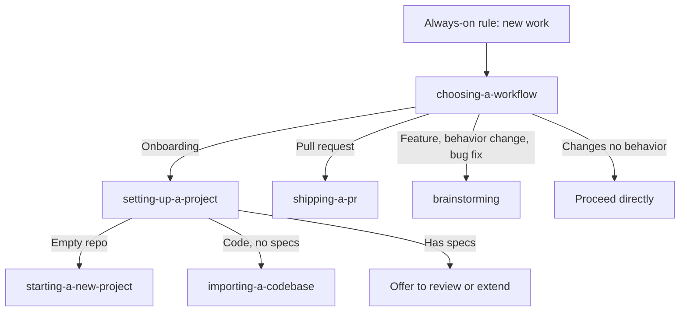

A workflow is a set of `pi` skills that tell the agent how to run a piece of work: ask before building,
record the design, amend the specs, ship the pull request. ThinkRail bundles a small family of them in
the `pi-thinkrail-workflow` package. This page lists each skill, how it starts, what it does, and what it
leaves behind. For why ThinkRail works this way, read [Living specs](living-specs.md).

## How workflows work

There is no workflow engine. A workflow is plain skill text that the agent reads and follows, so a run is
as reliable as the model following the instructions. Skills come in three roles:

- **Router.** Classifies the work and names the skill that governs it.
- **Worker.** Carries out the steps of one workflow.
- **Concept.** Holds norms that several workers share, such as how to ask questions or how to write a
  spec. Workers load concepts by name.

The workflow skills use `ask_user_question` to interview you, so they run only inside ThinkRail. The
[spec tools](../agent/agent-tools.md#spec-graph-tools) and the [TODO plan](../agent/agent-tools.md#todo-plan-tools) are
separate packages that the workflows build on.

## How a workflow starts

| Trigger | What happens |
| --- | --- |
| **Always-on routing rule** | A short rule is added to every chat's system prompt. At the start of new work it tells the agent to read the `choosing-a-workflow` skill before any other tool call when the work is project onboarding, pull request lifecycle work (including checking a PR's CI), or any change to what the product does: a feature, a behavior change, or a bug fix, however small. Questions, explanations, checks, and edits that change no behavior (typos, documentation-only or configuration-only edits, mechanical refactors) proceed without a workflow. Work already routed to a workflow continues without routing again. |
| **`/skill:<name>`** | Type `/skill:` in the composer and pick a skill, or type the full command. This forces the skill to load instead of relying on the agent to match its description. Text after the name is passed to the skill as your request. |
| **Welcome card** | In a project with no specs, **Set up project** on the Welcome screen opens the **Create workspace** dialog with `/skill:setting-up-a-project` already in the prompt. A project that has specs shows **Start building** instead. |
| **Skill description** | Skills with a narrow description, such as `setting-up-a-project`, `starting-a-new-project`, `importing-a-codebase`, and `shipping-a-pr`, can also load when the request matches. |

You can see which skills a chat has, and turn them on or off, in the **Skills** dialog. Skills from other
agents' folders and from the project are covered in [Use existing skills](../extend/use-existing-skills.md).

## Maturity

The workflows are in active use but are not equally proven. The routing in `choosing-a-workflow` and the
route into `brainstorming`, `setting-up-a-project`, and `importing-a-codebase` have been observed working
in automated runs against a real model. Other parts have been written but not yet observed in use:

| Skill | Observed working | Not yet observed |
| --- | --- | --- |
| `choosing-a-workflow` | Every classification, including small behavior changes and bug reports. | |
| `brainstorming` | Routing in, a small specified change, a bug report reaching the bug branch with no source edit, and a mid-flow round trip. | The full two-phase interview and the self-driven spec amendment. |
| `setting-up-a-project` | Routing to the new-project and import paths. | The offer to review or extend an existing graph. |
| `starting-a-new-project` | Routing in. | The interview and the goal-document template itself. |
| `importing-a-codebase` | The first-graph flow end to end in the browser test, and the offer to adopt existing documents. | The "why" and known-limitation questions. |
| `shipping-a-pr` | | Snapshot-by-default completion and reuse of earlier verification. |
| `asking-user-questions` | An earlier single-round form. | The current multi-round interview model. |
| `writing-specs` | Loaded and applied when revising a spec. | |

> [!NOTE]
> Treat each workflow as a strong default, not a guarantee. If the agent skips a step, name the skill with
> `/skill:<name>` and tell it which step it missed. Automated workflow tests run on demand, spend real
> provider tokens, and are not part of the ordinary build checks.

## Router

### `choosing-a-workflow`

The root router. It classifies new work with three questions and names exactly one outcome.

1. Is this **project onboarding**: no spec graph yet, either an empty workspace with a raw idea or an
   existing codebase being set up for the first time?
2. Is this the **pull request lifecycle**: finished work shipping as a pull request, or an existing pull
   request being tended? Fixes that come from a pull request's own review comments belong here.
3. Does the work **change what the product does**: a feature, a behavior change, or a bug fix?

| Classification | Routes to |
| --- | --- |
| Onboarding | `setting-up-a-project` |
| Pull request lifecycle | `shipping-a-pr` |
| Feature, behavior change, or bug fix | `brainstorming` |
| None of the above | No workflow; the agent proceeds directly and does not announce a routing result |

If the route is unclear, the agent asks one short clarifying question. A request that bundles unfinished
implementation with pull request work routes the implementation first.

**Output:** none. The router only hands off.

## Design and build

### `brainstorming`

**Starts:** the router, for any feature, behavior change, or bug fix. Depth scales with the change and never
drops to zero: a small change gets one short round and a few lines of design. The agent does not implement
until you have accepted the design; a design or acceptance criteria already in your request count as
approval of what they cover.

**Steps:**

1. **Orient.** Find the specs that govern the area through the spec graph, then confirm details in code.
2. **Scope check.** Separate independent product decisions or subsystems.
3. **Open a task-spec** at `.thinkrail/context/TASK-<slug>.md` with `status: draft` and the nearest
   relevant module as `parent`.
4. **Bug?** For a bug report, follow the bug branch below, which rejoins at step 5 or step 8.
5. **Product phase.** Interview what the change is for: why, for whom, what you will see and do including
   empty, error, and edge states, and how you will know it is done. Questions come in rounds until no
   decision is assumed. The answers go in the task-spec's Product section and are confirmed with one
   question before any technical choice.
6. **Technical phase.** Interview the decisions the product answers leave open: constraints,
   compatibility, verification, and the reason behind any decision whose reason is not recorded. Rejected
   alternatives are shown with their trade-off. The Design section records the chosen approach.
7. **Self-review, then review once.** The agent removes placeholders, contradictions, and scope creep, then
   presents one design and asks for approval unless the request already approved it.
8. **Build** against the accepted design, then review its own diff for suppressed lint or type errors,
   duplicated logic, rationale left as code comments, and leftovers of a replaced pattern.
9. **Amend specs.** See the amend step below.

**Bug branch (`fixing-a-bug`).** Pin the symptom, expected behavior, and trigger; reproduce when a safe
command can show it, ideally with a failing test; locate the code and its specs; then classify the bug as
**Silent** (no spec covers the behavior), **Wrong** (a spec states the buggy behavior), **Right** (the spec
is correct and only the code is wrong), or **Feature** (the code does what the specs intend, so this is a
new capability and the flow continues at step 5). The confirmed intended behavior is recorded in the
task-spec's Bug section and counts as the accepted design. The fix is test-first when practical.

**Amend step (`amending-specs`).** The agent updates the durable specs itself, top-down from the goal
document to architecture to module specs, without asking you to approve each edit. It writes decisions and
their reasons once, in the spec that owns them, runs `spec_validate`, makes no edits when nothing durable
changed, reports in a line or two which specs changed, and deletes the task-spec.

**Outputs:** a temporary task-spec (deleted at the end), the code change, amended durable specs, and a short
report. The edits land on the workspace branch, so you review them in **Changes** with the code. Pull
request work, if you ask for it, starts `shipping-a-pr` separately.

## Project setup

### `setting-up-a-project`

**Starts:** the router, the **Set up project** card, `/skill:setting-up-a-project`, or a request such as
"set up this project". It is a dispatcher and does no drafting itself.

**Steps:** detect whether the workspace has a spec graph and whether it has real source code, using the spec
tools, then route:

| Situation | Result |
| --- | --- |
| Already has specs | Does not redo setup. Offers to review or extend the graph, for example a missing architecture document or un-specced modules. Declining stops. Accepting continues on the agent's own judgment, with no dedicated skill, against the `writing-specs` bar. |
| No specs, empty or near-empty repository | `starting-a-new-project` |
| No specs, real source code | `importing-a-codebase` |

**Output:** none of its own.

### `starting-a-new-project`

**Starts:** `setting-up-a-project` for an empty workspace with a raw idea, or a matching request.

**Steps:**

1. State the plan: settle the goal and scope, then save `goal-and-requirements.md`.
2. Infer and confirm an **Overview**, then a **Problem** statement, using questions tailored to the domain.
3. Choose the template from inferred context: a short **Personal spec** for personal or first-person
   projects, or a full product requirements document for public or multi-user projects.
4. Elicit the template's sections one at a time, inferring a draft and letting you correct it, and save each
   confirmed section as you go.
5. Offer to research alternatives with `web_search` and `fetch_content` and add an **Alternatives
   Considered** section.
6. Show the full draft for review, then finalize.

A request that already reads like a spec is treated as confirmed and saved immediately; the agent asks only
about what is missing.

**Outputs:** `goal-and-requirements.md` at the project root, created with `status: draft` and set to
`active` when you approve the reviewed draft. The workflow ends there and suggests sketching
`architecture.md` next.

### `importing-a-codebase`

**Starts:** `setting-up-a-project` for a repository with code and no specs, or a matching request.

**Steps:**

1. **Read first, ask last.** Read agent files (`AGENTS.md`, `CLAUDE.md`, Cursor and Copilot rule files),
   documentation, manifests, and entry points. Collect existing architecture documents, decision records,
   glossaries, and contract documents as candidates to adopt.
2. **Build a working model** in the conversation: purpose, domain, stack, module boundaries and their
   dependencies, invariants the code enforces, and non-obvious decisions.
3. **Interview only the gaps.** Ask what the files cannot answer and what would change a spec: the primary
   job, non-goals, the reason behind non-obvious decisions, known limitations, and which candidate
   documents to adopt. If the files answer everything, the interview is skipped and the agent says so.
4. **Draft the graph top-down.** `goal-and-requirements.md`, then `architecture.md`, then one short
   `SPEC.md` per genuine module. Adopted documents gain frontmatter in place and keep their content,
   except where they have drifted from the code and the correction is called out.
5. **Validate and hand off.** Run `spec_validate`, then tell you what was inferred versus confirmed, which
   documents were adopted, and any corrections.

**Outputs:** a draft spec graph on the workspace branch. You review it in **Changes**; nothing reaches your
base branch until you merge it. Everything starts as `draft`.

## Shipping

### `shipping-a-pr`

**Starts:** the router, or a request to create a pull request, bring it up to date, update its title or
body, add screenshots, check CI, or address review comments. It uses the `gh` CLI.

**Modes.** *Snapshot* is the default: one fresh read of checks and merge state, reported as observed, with
no polling and no repair. *Wait* applies only when you explicitly ask to monitor or watch checks, wait until
green, or make the pull request merge-ready; it finishes only when every configured check is green, the
head is current with its base, and GitHub reports an affirmative merge state. A repository with no CI is
reported as having none.

**Rules for every phase.** The agent re-verifies the state it is about to change immediately before it
pushes or edits; keeps verification tied to the final tree; fetches remote state fresh; and treats a
pending or unknown answer as indeterminate rather than good.

| Ask | Phase | What it does |
| --- | --- | --- |
| Create a PR | `creating` | Five gates in order: committed and clean worktree, fresh rebased base, clean branch with no scratch files, verification evidence for the final tree, and a self-review of the full diff. Then the title (`scope: imperative summary`), a body that follows the repository's pull request template or the Summary, Changes, Testing shape (and reuses the plan summary when a TODO plan drove the work), push, and `gh pr create`. |
| Bring it up to date | `syncing` | Fetch, rebase or merge following the pull request's existing style, resolve conflicts by reading both sides' history, and reassess which verification the changes invalidated. |
| Update title or body | `body` | Fetch the current text, apply only the requested change, re-fetch immediately before editing, and verify the result. |
| Add screenshots | `screenshots` | Capture matching before and after shots of the same scenario and attach them without adding them to the pull request's files. |
| Check CI or merge state | `checks` | Snapshot or wait, as above. Every phase ends here. |
| Address review comments | `review-comments` | Read the whole pull request, give each comment a verdict (apply, push back, or clarify) before touching code, apply accepted changes, push, then reply to every thread. |

**Outputs:** the pull request, plus working files under `.thinkrail/context/`: `pr-body.md` for the body
draft and `pr-shots/` for staged screenshots. Both are deleted when their phase completes. This workflow is
separate from ThinkRail's built-in **Open PR** button; see
[Open a pull request](../review/open-a-pull-request.md).

## Concept skills

These are loaded by name from the workers above. They are not workflows and have nothing to run.

| Skill | Purpose |
| --- | --- |
| `asking-user-questions` | Norms for `ask_user_question` rounds: multi-round interviews, question quality, option design, confirming inferences, and what to do when you skip a question. |
| `writing-specs` | The quality bar for any spec a workflow writes: short, honest, and on-rails. |
| `writing-workflow-skills` | An authoring checklist for changing this skill family. It is staged into every project but does nothing outside the ThinkRail repository. |

## Other bundled skills

Three more skills ship with every chat but are tool guides, not workflows.

| Skill | Purpose |
| --- | --- |
| `spec-graph` | How to use the `spec_*` tools and the spec frontmatter. See [Spec format](spec-format.md). |
| `todos` | How to keep the chat's TODO plan: groups as tasks, one step in progress, promote loose items, and re-read the list because you edit it too. |
| `managing-mcp-servers` | How to edit `mcp.json` safely. It tells the agent to use the config files and **Settings → MCP servers**, not `pi mcp` commands, because ThinkRail has no `pi` executable. See [MCP configuration](../extend/mcp-configuration.md). |

## Related

- [Living specs](living-specs.md)
- [Set up a project for spec-first work](spec-first-project.md)
- [Tools the agent can call](../agent/agent-tools.md)
- [Use existing skills](../extend/use-existing-skills.md)
