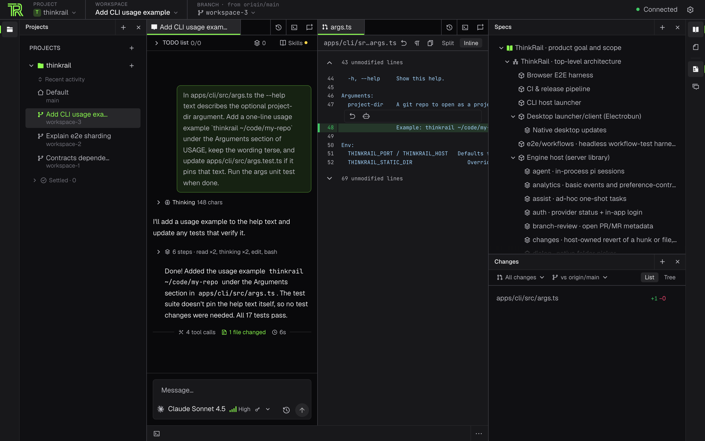

ThinkRail is a free, open-source agentic IDE for working with a coding agent on your own git
repositories. Each task runs in its own copy of the repository, and you review what the agent changed as
a diff before anything ships. Your project's intent and decisions live in specs that the agent reads and
keeps current, so it does not relearn the project every session and its work stays consistent with what
you decided. This page answers the questions people ask before installation.

## What it is, in plain words

You open a git repository in ThinkRail and describe a task in a chat. The agent reads and edits files,
runs commands, and reports back while you watch, steer it, or start another task in parallel. Around the
chat you get an editor, a live git **Changes** view, terminals, and diff review, all scoped to the task's
workspace.

ThinkRail comes as a desktop app or as the `thinkrail` CLI, which opens the same app in your browser.

## What makes it different

### Spec-first

A chat ends, and the decisions made in it end with it unless they are written down. ThinkRail keeps a
project's intent in a graph of Markdown specs beside the code: `goal-and-requirements.md` for the goal,
`architecture.md` for cross-cutting decisions, and a `SPEC.md` beside each module. The agent searches,
reads, and updates that graph through dedicated `spec_*` tools, reads the spec closest to the code it
touches, and amends the affected specs in the same change as the code. Spec edits show up in **Changes**
and you review them like any other edit. A project without specs gets a **Set up project** action that
drafts them with you. See [Living specs](specs/living-specs.md) for how it works and why.

### Parallel agents in isolated workspaces

Each task gets its own workspace: a git worktree on its own branch, with its own working directory. Several
agents can run at once, each in a different workspace, and none of them touches your own checkout. You
read each diff, leave comments that go back to the agent, and merge the branch you want to keep. Working
directly in your project folder is possible, but it is an explicit choice. See
[Workspaces and isolation](workspaces/workspaces-and-isolation.md),
[Review changes](review/review-changes.md), and
[Open a workspace in your editor](workspaces/open-in-your-editor.md).

### Bring your own model

ThinkRail has no accounts and no models of its own. You sign in with a subscription you already pay for
(Claude, ChatGPT, or GitHub Copilot), use JetBrains AI, or add an API key for any provider `pi` supports,
such as Anthropic, OpenAI, Google, or OpenRouter. Each chat has its own model, so two chats in the same
workspace can use different providers. See [Connect a model provider](get-started/connect-a-provider.md)
and [Choose models and effort](agent/choose-models.md).

### Open and extensible, built on pi

ThinkRail is open source under the Apache License 2.0. Its agent is [`pi`](https://pi.dev), an MIT-licensed
open-source coding agent that otherwise runs in a terminal. ThinkRail runs `pi` inside its own process and
builds the UI around it, so models, credentials, skills, and sessions all belong to `pi`. Your existing
`pi` setup, skills, extensions, MCP servers, and prompt templates keep working, and ThinkRail's own
portable packages also run in plain `pi`. See [ThinkRail and pi](agent/thinkrail-and-pi.md) and
[Extensions](extend/extensions.md).

## Who it is for

- **Newcomers to AI-first coding** who want modern tools fit for the job, and want to see and review what
  an agent does instead of reading a terminal scrollback.
- **`pi` users** who want an IDE around the agent without giving up their setup. See
  [Coming from pi](coming-from-pi.md).
- **Builders who run several agents at once** and want each one's work isolated and reviewable.
- **Power AI users** who want full customization and extensibility, without the lock-in of a proprietary
  tool.

## What you need

- **A computer ThinkRail runs on:** macOS on Apple Silicon, Windows x64, or Linux x64 or ARM64. See
  [Platform support](run/platform-support.md).
- **`git` on your `PATH`**.
- **A model provider:** a subscription sign-in, JetBrains AI through the JetBrains `central` CLI, or an
  API key. See [Bring your own model](#bring-your-own-model).
- **Recommended: the GitHub CLI (`gh`)**, signed in, to open pull requests in one click.

## What it costs

ThinkRail itself is free and open source under the Apache License 2.0. What you pay for is the model access:

| Model option | What you pay |
| --- | --- |
| Subscription sign-in | Nothing extra beyond your plan. Your plan's usage limits apply. |
| JetBrains AI | Your JetBrains AI credits. The top bar can show how many remain. |
| API key | The provider's per-token prices. The model picker shows them per million tokens. |

The chat header shows token use and cost as `pi` reports them.

`pi`'s sign-in flows are written for ChatGPT Plus and Pro and for Claude Pro and Max plans, and a GitHub
Copilot sign-in exists alongside them.

## How it compares

ThinkRail is an agentic IDE built around `pi`, rather than an editor with AI added or an agent of its
own.

| Tool | What it is | How ThinkRail relates |
| --- | --- | --- |
| **Cursor** | An AI code editor based on VS Code, with its own agent and plans | ThinkRail is not subscription-bound, you bring your own model. |
| **Claude Code** | Anthropic's coding agent for the terminal and IDEs, using Claude models | ThinkRail runs a different agent, `pi`, which can use your Claude plan or key alongside many other providers. It reads skills from `~/.claude/skills` and a project's `CLAUDE.md`. |
| **GitHub Copilot** | GitHub's coding assistant in editors and on GitHub | ThinkRail can use your Copilot subscription as a model provider. It opens pull requests through your own `gh`; it has no merge button and no code-review integration with GitHub. |
| **Plain `pi`** | The same agent in a terminal | ThinkRail adds isolated workspaces, diff review with comments sent back to the agent, specs, plans, and a UI, and shares your `pi` setup. Keep the `pi` CLI for terminal and scripted work. |

> [!WARNING]
> The descriptions of Cursor, Claude Code, and GitHub Copilot summarize how those products
> present themselves. They are not a feature-by-feature comparison. Check each product's own docs.

## Maturity

- **Early.** ThinkRail is at version 0.x and is a JetBrains incubator project.
- **Two channels.** Stable releases (`v0.1.x`) and Nightly builds (`0.2.0-nightly.N`) are published most days and carry everything merged since the last stable. See [Install ThinkRail](get-started/install.md#choose-a-channel-or-pin-a-version) and the [changelog](changelog.md).
- **No published support policy.** There is no stated stability promise or support commitment yet.
  Report bugs in [GitHub issues](https://github.com/JetBrains/thinkrail/issues) and ask questions on
  [Discord](https://discord.gg/Wybu9ceWkY). See [Get help](run/get-help.md).

For what leaves your machine, what the agent can do without asking, and how to turn off usage data, see
[Security and data overview](security/security-and-data-overview.md).

## License

ThinkRail is open source under the [Apache License 2.0](https://github.com/JetBrains/thinkrail/blob/main/LICENSE).
The source is on [GitHub](https://github.com/JetBrains/thinkrail).

## Next steps

- [Install ThinkRail](get-started/install.md)
- [Describe your project](get-started/describe-your-project.md)
- [Make your first change](get-started/first-change.md)
- [Run agents in parallel](workspaces/parallel-workspaces.md)
